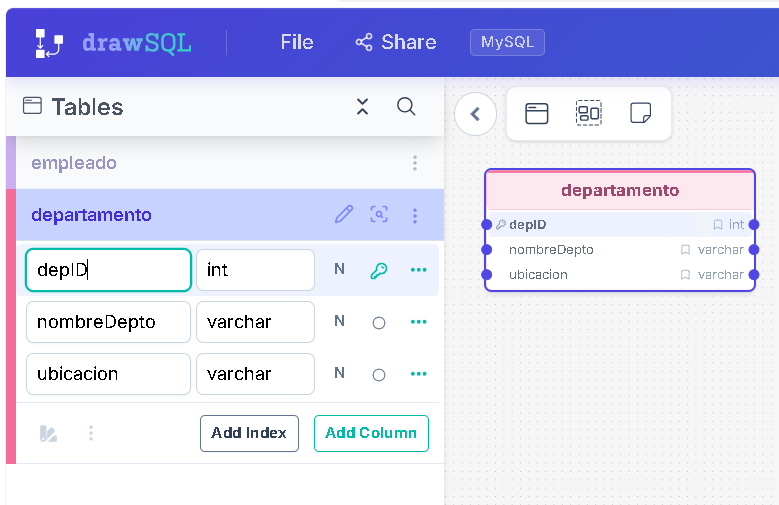
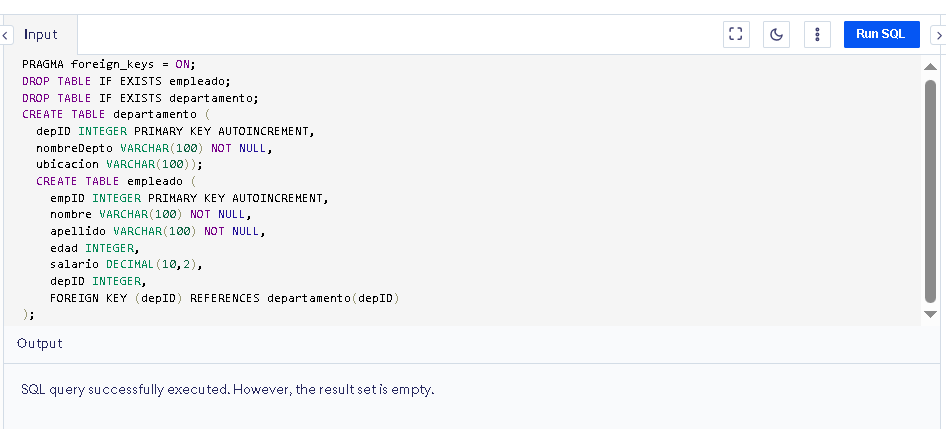
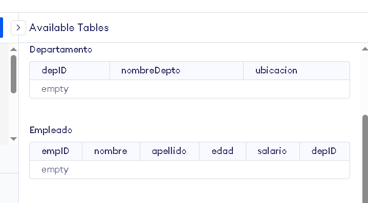

# Diseño lógico y físico de base de datos

Este repositorio reúne el documento y los diagramas de un modelo relacional para administrar empleados y departamentos. Los diagramas se elaboraron con [drawSQL](https://drawsql.app/) usando el dialecto MySQL.

## Modelo de datos

El esquema contiene dos tablas:

| Tabla | Campo | Tipo | Descripción |
|---|---|---|---|
| `departamento` | `depID` | `int` | Clave primaria |
| `departamento` | `nombreDepto` | `varchar` | Nombre del departamento |
| `departamento` | `ubicacion` | `varchar` | Ubicación del departamento |
| `empleado` | `empID` | `int` | Clave primaria |
| `empleado` | `nombre` | `varchar` | Nombre del empleado |
| `empleado` | `apellido` | `varchar` | Apellido del empleado |
| `empleado` | `edad` | `int` | Edad del empleado |
| `empleado` | `salario` | `decimal` | Salario del empleado |
| `empleado` | `depID` | `int` | Clave foránea hacia `departamento.depID` |

La relación es de uno a muchos: un departamento puede tener varios empleados y cada empleado se asocia a un departamento mediante `empleado.depID`.

## Diseño en línea

Consulta el diseño lógico de la base de datos en [drawSQL](https://drawsql.app/draw?t=70e28087-9b49-406b-97f7-1f892b5cd6ef&view=1).

## Diagramas

### Tabla `empleado`

### Tabla `departamento`

### Relación entre las tablas

## Implementación SQL

El esquema se creó con sentencias SQL. La definición establece claves primarias autoincrementales, campos obligatorios para el nombre y apellido del empleado, y una clave foránea desde `empleado.depID` hacia `departamento.depID`.

### Creación de las tablas

### Resultado de las tablas

### Estructura del esquema

## Documento

El documento de trabajo está disponible en [`DISEÑO_LÓGICO_FÍSICO_WORKBENCH.docx`](DISE%C3%91O_L%C3%93GICO_F%C3%8DSICO_WORKBENCH.docx).
