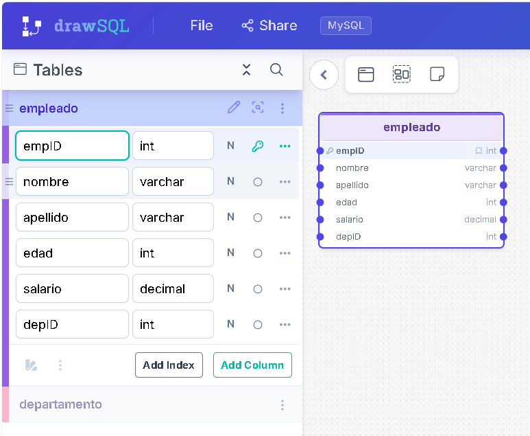
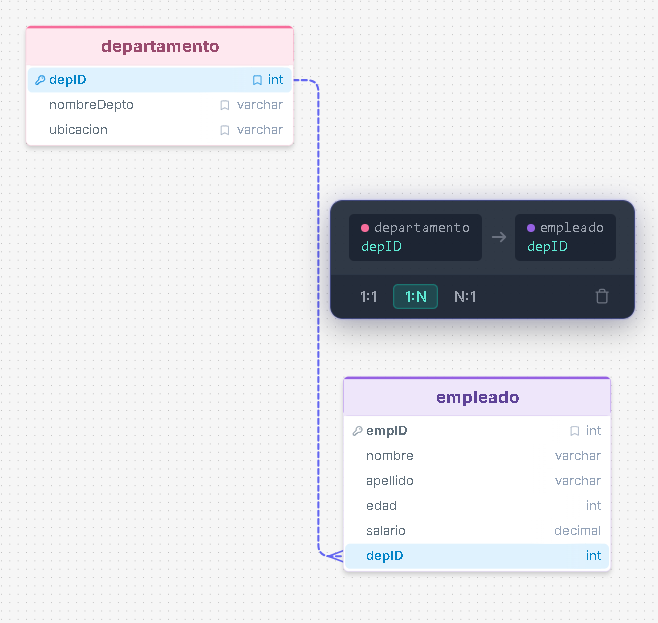

# Diseño lógico y físico de base de datos

Este repositorio reúne el documento y los diagramas de un modelo relacional para administrar empleados y departamentos. Los diagramas se elaboraron con [drawSQL](https://drawsql.app/) usando el dialecto MySQL.

## Modelo de datos

El esquema contiene dos tablas:

| Tabla | Campo | Tipo | Descripción |
|---|---|---|---|
| `departamento` | `depID` | `int` | Clave primaria |
| `departamento` | `nombreDepto` | `varchar` | Nombre del departamento |
| `departamento` | `ubicacion` | `varchar` | Ubicación del departamento |
| `empleado` | `empID` | `int` | Clave primaria |
| `empleado` | `nombre` | `varchar` | Nombre del empleado |
| `empleado` | `apellido` | `varchar` | Apellido del empleado |
| `empleado` | `edad` | `int` | Edad del empleado |
| `empleado` | `salario` | `decimal` | Salario del empleado |
| `empleado` | `depID` | `int` | Clave foránea hacia `departamento.depID` |

La relación es de uno a muchos: un departamento puede tener varios empleados y cada empleado se asocia a un departamento mediante `empleado.depID`.

## Diagramas

### Tabla `empleado`

### Tabla `departamento`

### Relación entre las tablas

## Documento

El documento de trabajo está disponible en [`DISEÑO_LÓGICO_FÍSICO_WORKBENCH.docx`](DISE%C3%91O_L%C3%93GICO_F%C3%8DSICO_WORKBENCH.docx).
